# HC_SR04

제품 성능

## 1. 목표

- HC-SR04로 거리를 측정한다.
- "몇 초마다 정확한 데이터를 확인한다"를 **측정 가능한 숫자**로 바꾼다.
- `HAL_Delay()` 없이 **비차단 상태 머신**으로 측정한다.
- 타임스탬프, 오류 횟수, 필터 결과를 UART CSV로 확인한다.
- LED 점멸은 계속 동작하게 두어 **여러 작업이 서로를 막지 않는지** 확인한다.

이번 단계에서 확정한 값:

| 항목 | 값 |
|---|---|
| 센서 | HC-SR04 |
| TRIG | PA1 (GPIO 출력) |
| ECHO | PA0 (EXTI 양쪽 에지) |
| 샘플 주기 | 200 ms (5 Hz) |
| 출력 주기 | 1000 ms (1 Hz) |
| 필터 | 최근 5개 중앙값 |
| 측정 타임아웃 | 35 ms |
| 유효 펄스 | 100 ~ 30000 us |
| 유효 거리 | 20 ~ 4000 mm |
| 음속 | 343 m/s (20 °C 기준) |
| 목표 정확도 | ±1 cm (0.2 ~ 2 m, 평평한 물체) |

## 2. 배선

### 2.1 HC-SR04 핀

| HC-SR04 | 연결 |
|---|---|
| VCC | NUCLEO **3.3 V** |
| GND | NUCLEO GND |
| TRIG | PA1 |
| ECHO | PA0 |

### 2.2 Pinmap

<p align="center">
  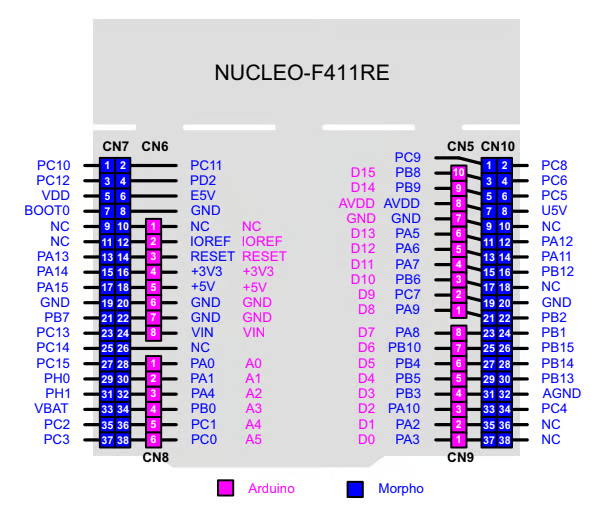
</p>

## 3. CubeMX Setting

### 3-1. CLK set

<p align="center">
  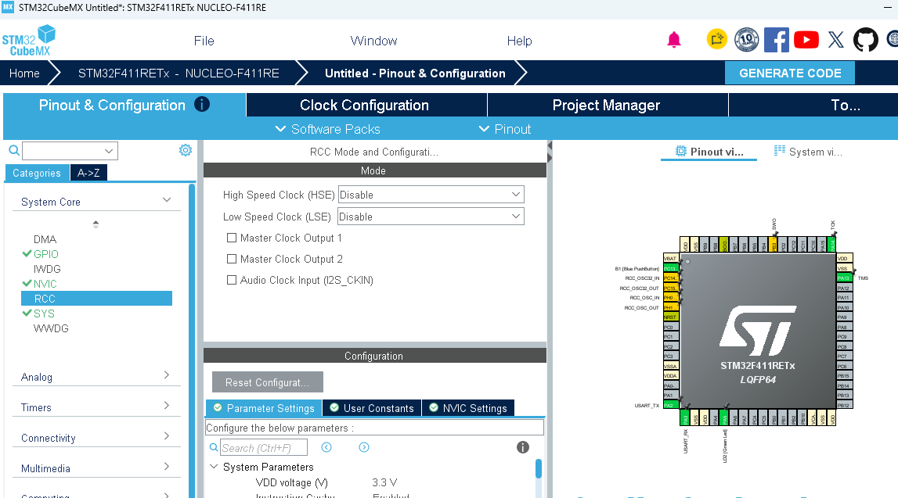
  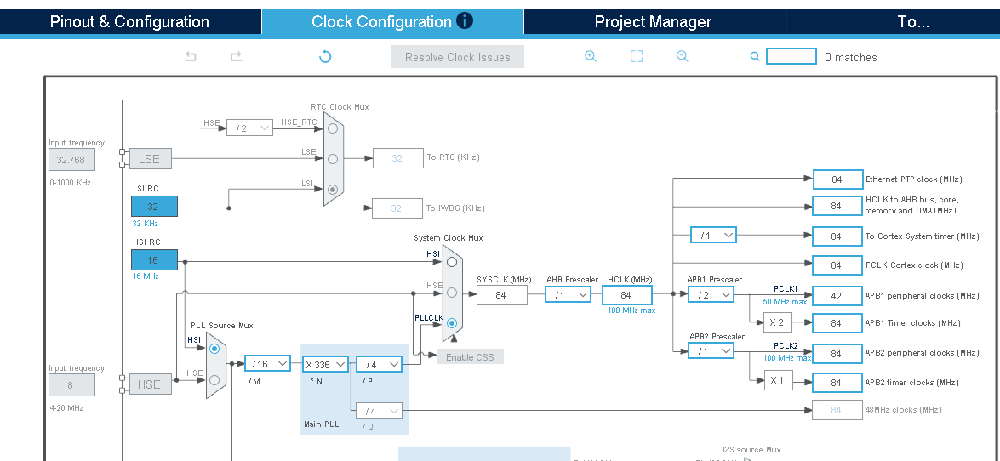
</p>

### 3-2. GPIO set

PA1을 TRIG Pin으로 설정하며 `GPIO_Output`으로 설정함.

PA0를 ECHO Pin으로 설정하며 *Interrupt*를 위해 `GPIO_EXTI0`로 설정함.
*Interrupt*를 ECHO의 Rising Edge & Falling Edge를 검출하기 위해 GPIO mode를 변경함.

<p align="center">
  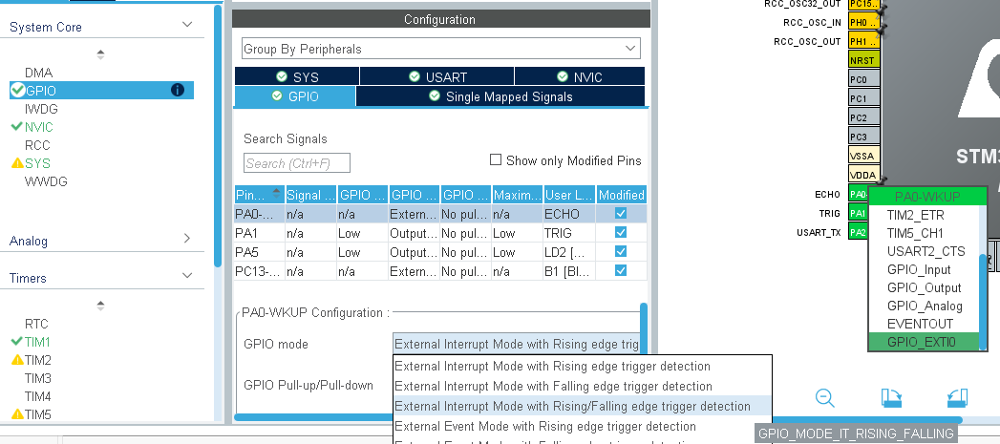  
</p>

NVIC 창에서 Interrupt를 Add 설정함.

<p align="center">
  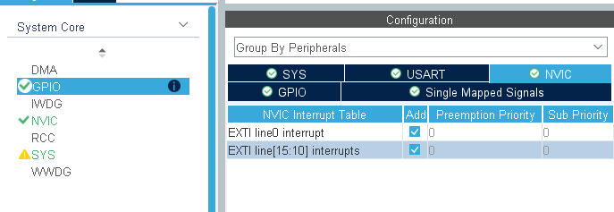  
</p>

### 3-3. TIM1 set

#### us를 설정하기 위한 TIM1 설정

84MHz 주기를 Prescaler를 84-1로 분주하여 1MHz를 만들고,
auto_reload preload를 Enable함.

<p align="center">
  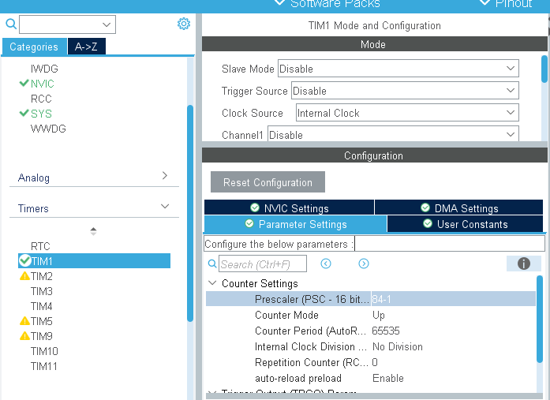  
</p>


## 4. 코드 수정 상세

###  4.1 ultrasonic.h : API

```c
#ifndef ULTRASONIC_H
#define ULTRASONIC_H

#ifdef __cplusplus
extern "C" {
#endif

#include <stdint.h>
#include "stm32f4xx_hal.h"

typedef struct
{
  uint32_t timestamp_ms;
  uint32_t errors;
  uint16_t distance_ref_mm;
  uint16_t distance_mm;
  uint8_t valid;
} Ultrasonic_Result;

extern volatile uint16_t g_trace_echo_ticks;
extern volatile uint8_t g_trace_echo_edge;
extern volatile uint8_t g_trace_echo_state;
extern volatile uint32_t g_trace_edge_count;

void Ultrasonic_Init(void);
void Ultrasonic_Task(void);
uint8_t Ultrasonic_GetResult(Ultrasonic_Result *result);
uint16_t Ultrasonic_GetLastEchoTicks(void);
uint8_t Ultrasonic_IsIdle(void);
void Ultrasonic_SetSoundSpeedX10(uint16_t speed_x10);
void Ultrasonic_OnEchoEdge(void);

#ifdef __cplusplus
}
#endif

#endif

```


### 4.2 `ultrasonic.c` - 거리 계산 핵심

```c
#define US_TIMER_TICKS_PER_US 1U
#define US_MIN_ECHO_TICKS (100U * US_TIMER_TICKS_PER_US)
#define US_MAX_ECHO_TICKS (30000U * US_TIMER_TICKS_PER_US)
```

```c
uint16_t Ultrasonic_GetLastEchoTicks(void)
{
  return s_echoWidthTicks;
}
```

```c
static void US_StoreSample(uint32_t width_ticks)
{
  uint32_t width_us = width_ticks / US_TIMER_TICKS_PER_US;
  uint32_t distance_ref_mm = (width_us * US_REFERENCE_SOUND_SPEED_X10) / 20000U;
  uint32_t distance_mm = (width_us * s_soundSpeedX10) / 20000U;
  ...
}
```

- `US_REFERENCE_SOUND_SPEED_X10 = 3430`은 343.0 m/s입니다.
- `/20000`은 mm/us로 환산한 뒤 왕복 시간을 2로 나누는 부분입니다.
- `width = (uint16_t)(fall_cnt - rise_cnt)`이므로 TIM1 16-bit 오버플로도 처리됩니다.

#### 전체코드

```c
#include "ultrasonic.h"
#include "main.h"

extern TIM_HandleTypeDef htim1;

#define US_SAMPLE_PERIOD_MS 200U
#define US_PUBLISH_PERIOD_MS 1000U
#define US_ECHO_TIMEOUT_MS 35U
#define US_TRIG_PULSE_US 10U
#define US_TIMER_TICKS_PER_US 1U
#define US_MIN_ECHO_TICKS (100U * US_TIMER_TICKS_PER_US)
#define US_MAX_ECHO_TICKS (30000U * US_TIMER_TICKS_PER_US)
#define US_MIN_DISTANCE_MM 20U
#define US_MAX_DISTANCE_MM 4000U
#define US_FILTER_SIZE 5U
#define US_REFERENCE_SOUND_SPEED_X10 3430U
#define US_DEFAULT_SOUND_SPEED_X10 US_REFERENCE_SOUND_SPEED_X10
#define US_MIN_SOUND_SPEED_X10 2500U
#define US_MAX_SOUND_SPEED_X10 4000U

typedef enum
{
  US_STATE_IDLE = 0,
  US_STATE_WAIT_ECHO
} Ultrasonic_State;

static TIM_HandleTypeDef *s_htim;
static volatile Ultrasonic_State s_state;
static uint32_t s_lastSampleTick;
static uint32_t s_lastPublishTick;
static uint32_t s_echoStartTick;
static uint16_t s_echoStartCnt;
static volatile uint16_t s_echoWidthTicks;
static volatile uint8_t s_echoRising;
static volatile uint8_t s_echoDone;
static uint16_t s_samplesRef[US_FILTER_SIZE];
static uint16_t s_samplesCorr[US_FILTER_SIZE];
static uint8_t s_sampleCount;
static uint8_t s_sampleIndex;
static uint32_t s_errorCount;
static uint16_t s_soundSpeedX10;
static Ultrasonic_Result s_result;
static volatile uint8_t s_resultReady;

static uint16_t US_GetCounter(void);
static void US_StoreSample(uint32_t width_ticks);
static uint16_t US_Median(const uint16_t *samples);
static void US_Publish(uint32_t now);

static uint16_t US_GetCounter(void)
{
  return (uint16_t)__HAL_TIM_GET_COUNTER(s_htim);
}

void Ultrasonic_Init(void)
{
  s_htim = &htim1;
  HAL_GPIO_WritePin(TRIG_GPIO_Port, TRIG_Pin, GPIO_PIN_RESET);

  if (HAL_TIM_Base_Start(s_htim) != HAL_OK)
  {
    Error_Handler();
  }

  s_state = US_STATE_IDLE;
  s_lastSampleTick = HAL_GetTick();
  s_lastPublishTick = s_lastSampleTick;
  s_echoStartTick = 0U;
  s_echoStartCnt = 0U;
  s_echoWidthTicks = 0U;
  s_echoRising = 0U;
  s_echoDone = 0U;
  s_sampleCount = 0U;
  s_sampleIndex = 0U;
  s_errorCount = 0U;
  s_soundSpeedX10 = US_DEFAULT_SOUND_SPEED_X10;
  s_resultReady = 0U;
  s_result.timestamp_ms = 0U;
  s_result.distance_ref_mm = 0U;
  s_result.distance_mm = 0U;
  s_result.valid = 0U;
  s_result.errors = 0U;
}

void Ultrasonic_Task(void)
{
  uint32_t now;
  uint16_t trigStartCnt;

  if (s_htim == NULL)
  {
    return;
  }

  now = HAL_GetTick();

  switch (s_state)
  {
    case US_STATE_IDLE:
      if ((now - s_lastSampleTick) >= US_SAMPLE_PERIOD_MS)
      {
        s_lastSampleTick = now;
        s_echoRising = 0U;
        s_echoDone = 0U;

        trigStartCnt = US_GetCounter();
        HAL_GPIO_WritePin(TRIG_GPIO_Port, TRIG_Pin, GPIO_PIN_SET);
        while ((uint16_t)(US_GetCounter() - trigStartCnt) < US_TRIG_PULSE_US)
        {
        }
        HAL_GPIO_WritePin(TRIG_GPIO_Port, TRIG_Pin, GPIO_PIN_RESET);

        s_echoStartTick = now;
        s_state = US_STATE_WAIT_ECHO;
      }
      break;

    case US_STATE_WAIT_ECHO:
      if (s_echoDone != 0U)
      {
        if (s_echoDone == 1U)
        {
          US_StoreSample(s_echoWidthTicks);
        }
        else
        {
          s_errorCount++;
        }
        s_echoDone = 0U;
        s_state = US_STATE_IDLE;
      }
      else if ((now - s_echoStartTick) >= US_ECHO_TIMEOUT_MS)
      {
        s_errorCount++;
        s_state = US_STATE_IDLE;
      }
      break;

    default:
      s_state = US_STATE_IDLE;
      break;
  }

  if ((now - s_lastPublishTick) >= US_PUBLISH_PERIOD_MS)
  {
    s_lastPublishTick = now;
    US_Publish(now);
  }
}

uint8_t Ultrasonic_GetResult(Ultrasonic_Result *result)
{
  if ((result == NULL) || (s_resultReady == 0U))
  {
    return 0U;
  }

  *result = s_result;
  s_resultReady = 0U;
  return 1U;
}

uint8_t Ultrasonic_IsIdle(void)
{
  return (s_state == US_STATE_IDLE) ? 1U : 0U;
}

void Ultrasonic_SetSoundSpeedX10(uint16_t speed_x10)
{
  if ((speed_x10 >= US_MIN_SOUND_SPEED_X10) && (speed_x10 <= US_MAX_SOUND_SPEED_X10))
  {
    s_soundSpeedX10 = speed_x10;
  }
}

uint16_t Ultrasonic_GetLastEchoTicks(void)
{
  return s_echoWidthTicks;
}

void Ultrasonic_OnEchoEdge(void)
{
  uint16_t now;
  uint16_t width;

  if (s_htim == NULL)
  {
    return;
  }

  now = US_GetCounter();

  if (HAL_GPIO_ReadPin(ECHO_GPIO_Port, ECHO_Pin) == GPIO_PIN_SET)
  {
    if ((s_state == US_STATE_WAIT_ECHO) && (s_echoRising == 0U))
    {
      s_echoStartCnt = now;
      s_echoRising = 1U;
    }
  }
  else if (s_echoRising != 0U)
  {
    width = (uint16_t)(now - s_echoStartCnt);
    s_echoRising = 0U;
    s_echoWidthTicks = width;

    if ((width >= US_MIN_ECHO_TICKS) && (width <= US_MAX_ECHO_TICKS))
    {
      s_echoDone = 1U;
    }
    else
    {
      s_echoDone = 2U;
    }
  }
}

static void US_StoreSample(uint32_t width_ticks)
{
  uint32_t width_us = width_ticks / US_TIMER_TICKS_PER_US;
  uint32_t distance_ref_mm = (width_us * US_REFERENCE_SOUND_SPEED_X10) / 20000U;
  uint32_t distance_mm = (width_us * s_soundSpeedX10) / 20000U;

  if ((distance_mm >= US_MIN_DISTANCE_MM) && (distance_mm <= US_MAX_DISTANCE_MM))
  {
    s_samplesRef[s_sampleIndex] = (uint16_t)distance_ref_mm;
    s_samplesCorr[s_sampleIndex] = (uint16_t)distance_mm;
    s_sampleIndex = (uint8_t)((s_sampleIndex + 1U) % US_FILTER_SIZE);
    if (s_sampleCount < US_FILTER_SIZE)
    {
      s_sampleCount++;
    }
  }
  else
  {
    s_errorCount++;
  }
}

static uint16_t US_Median(const uint16_t *samples)
{
  uint16_t sorted[US_FILTER_SIZE];
  uint8_t i;
  uint8_t j;

  for (i = 0U; i < s_sampleCount; i++)
  {
    sorted[i] = samples[i];
  }

  for (i = 0U; (uint8_t)(i + 1U) < s_sampleCount; i++)
  {
    for (j = (uint8_t)(i + 1U); j < s_sampleCount; j++)
    {
      if (sorted[j] < sorted[i])
      {
        uint16_t temp = sorted[i];
        sorted[i] = sorted[j];
        sorted[j] = temp;
      }
    }
  }

  return sorted[s_sampleCount / 2U];
}

static void US_Publish(uint32_t now)
{
  s_result.timestamp_ms = now;

  if (s_sampleCount > 0U)
  {
    s_result.distance_ref_mm = US_Median(s_samplesRef);
    s_result.distance_mm = US_Median(s_samplesCorr);
    s_result.valid = 1U;
  }
  else
  {
    s_result.distance_ref_mm = 0U;
    s_result.distance_mm = 0U;
    s_result.valid = 0U;
  }

  s_result.errors = s_errorCount;
  s_resultReady = 1U;

  s_sampleCount = 0U;
  s_sampleIndex = 0U;
}
```

### 4.3 `main.c` - EXTI 콜백 분기

```c
/* USER CODE BEGIN 4 */
void HAL_GPIO_EXTI_Callback(uint16_t GPIO_Pin)
{
  if (GPIO_Pin == ECHO_Pin)
  {
    Ultrasonic_OnEchoEdge();
  }
  else if (GPIO_Pin == B1_Pin)
  {
    HAL_GPIO_TogglePin(LD2_GPIO_Port, LD2_Pin);
  }
}
/* USER CODE END 4 */
```

#### 전체코드

```c
/* USER CODE BEGIN Includes */
#include <stdio.h>
#include "ultrasonic.h"
/* USER CODE END Includes */
```

```c
/* USER CODE BEGIN 0 */
#ifdef __GNUC__
#define PUTCHAR_PROTOTYPE int __io_putchar(int ch)
#else
#define PUTCHAR_PROTOTYPE int fputc(int ch, FILE *f)
#endif

PUTCHAR_PROTOTYPE
{
  if (ch == '\n')
  {
    HAL_UART_Transmit(&huart2, (uint8_t *)"\r", 1, 0xFFFF);
  }
  HAL_UART_Transmit(&huart2, (uint8_t *)&ch, 1, 0xFFFF);

  return ch;
}

static void Sensor_Task(void)
{
  Ultrasonic_Result result;
  char line[80];

  Ultrasonic_Task();

  if (Ultrasonic_GetResult(&result) != 0U)
  {
    (void)snprintf(line, sizeof(line), "D,%lu,%u,%u,%lu\n",
                   (unsigned long)result.timestamp_ms,
                   (unsigned int)result.distance_mm,
                   (unsigned int)result.valid,
                   (unsigned long)result.errors);
    printf("%s", line);
    printf("C,%u\n", (unsigned int)Ultrasonic_GetLastEchoTicks());
  }
}
/* USER CODE END 0 */
```

```c
  /* USER CODE BEGIN 2 */
  Ultrasonic_Init();
  printf("\n=== F411_TASK_LAB Step 2: Ultrasonic ===\n");
  printf("HC-SR04: TRIG=PA1, ECHO=PA0, 5 Hz sample, 1 Hz median\n");
  printf("TIM1: PCLK2=%luHz divider=%lu ARR=%lu tick=%luHz\n",
         (unsigned long)HAL_RCC_GetPCLK2Freq(),
         (unsigned long)(htim1.Init.Prescaler + 1U),
         (unsigned long)htim1.Init.Period,
         (unsigned long)(HAL_RCC_GetPCLK2Freq() / (htim1.Init.Prescaler + 1U)));
  /* USER CODE END 2 */
```

```c
  /* Infinite loop */
  /* USER CODE BEGIN WHILE */
  while (1)
  {
    /* USER CODE END WHILE */

    /* USER CODE BEGIN 3 */
    Sensor_Task();
  }
  /* USER CODE END 3 */
```

```c
/* USER CODE BEGIN 4 */
void HAL_GPIO_EXTI_Callback(uint16_t GPIO_Pin)
{
  if (GPIO_Pin == ECHO_Pin)
  {
    Ultrasonic_OnEchoEdge();
  }
  else if (GPIO_Pin == B1_Pin)
  {
    HAL_GPIO_TogglePin(LD2_GPIO_Port, LD2_Pin);
  }
}
/* USER CODE END 4 */
```

### 4.4 `stm32f4xx_it.c` / `stm32f4xx_it.h`

```c
void EXTI0_IRQHandler(void)
{
  HAL_GPIO_EXTI_IRQHandler(ECHO_Pin);
}

void EXTI15_10_IRQHandler(void)
{
  HAL_GPIO_EXTI_IRQHandler(B1_Pin);
}
```

```c
void EXTI0_IRQHandler(void);
void EXTI15_10_IRQHandler(void);
```

#### 전체코드

```c
/**
  * @brief This function handles EXTI line0 interrupt.
  */
void EXTI0_IRQHandler(void)
{
  /* USER CODE BEGIN EXTI0_IRQn 0 */

  /* USER CODE END EXTI0_IRQn 0 */
  HAL_GPIO_EXTI_IRQHandler(ECHO_Pin);
  /* USER CODE BEGIN EXTI0_IRQn 1 */

  /* USER CODE END EXTI0_IRQn 1 */
}

/* USER CODE BEGIN 1 */
void EXTI15_10_IRQHandler(void)
{
  HAL_GPIO_EXTI_IRQHandler(B1_Pin);
}
/* USER CODE END 1 */
```

## 5. 결과

### 5-1. Scope

- Echo Pin을 Scope로 측정 결과임.

<p align="center">
  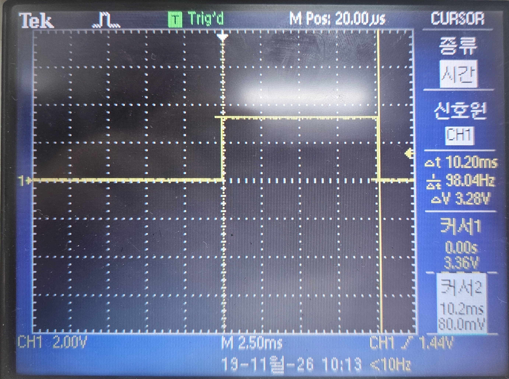
</p>

### 5-2. Serial 통신

- Serial 통신으로 거리 측정 결과

<p align="center">
  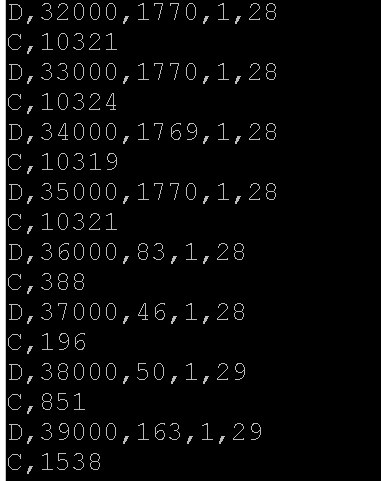
</p>

### 5-3. SWV 데이터 그래프

- SWV 데이터 그래프로 Trig & Echo 결과

<p align="center">
  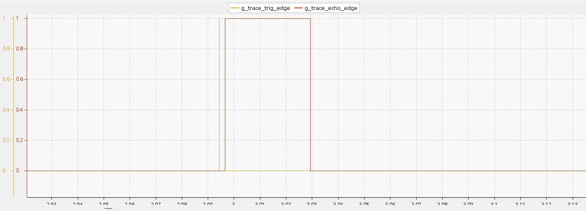
</p>

## 6. 온습도 보정

### 6-1. 핀 / 타이머 매핑 (최종)

| 신호 | 핀 | 용도 | 비고 |
|---|---|---|---|
| ECHO | PA0 | HC-SR04 에코 | EXTI0, 기존 유지 |
| TRIG | PA1 | HC-SR04 트리거 | 기존 유지 |
| USART2_TX | PA2 | 시리얼 출력 | 기존 유지 |
| USART2_RX | PA3 | 시리얼 수신 | 기존 유지 |
| **DHT DATA** | **PA4** | 온습도 단일선 데이터 | 내부 풀업 사용, Open-Drain으로 전환 |
| LD2 | PA5 | 보드 LED | 기존 유지 |
| 시간 기준 | TIM1 | 1 MHz 카운터 | 초음파·DHT 공용 |

---

### 6-2. 변경 파일 목록

| 파일 | 변경 내용 |
|---|---|
| `Core/Inc/dht.h` | 신규 추가 (첨부 파일 그대로, `Dht_Result` / `Dht_Init` / `Dht_Task` / `Dht_GetResult`) |
| `Core/Src/dht.c` | 신규 추가 + 메인 맞춤 수정 (아래 3.1) |
| `Core/Src/main.c` | DHT 초기화·태스크 호출, 음속 보정, 시리얼 출력 추가 (아래 3.2) |
| `Debug/Core/Src/subdir.mk` | `dht.c`를 빌드 소스/오브젝트/의존성/clean에 추가 |
| `Debug/objects.list` | 링커 입력에 `./Core/Src/dht.o` 추가 |


### dht.h

```c
#ifndef DHT_H
#define DHT_H

#ifdef __cplusplus
extern "C" {
#endif

#include <stdint.h>

typedef struct
{
  uint32_t timestamp_ms;
  uint32_t errors;
  int16_t temperature_c_x10;
  uint16_t humidity_rh_x10;
  uint8_t valid;
} Dht_Result;

void Dht_Init(void);
void Dht_Task(void);
uint8_t Dht_GetResult(Dht_Result *result);

#ifdef __cplusplus
}
#endif

#endif
```

### dht.c

```c
#include "dht.h"
#include "main.h"

extern TIM_HandleTypeDef htim1;

#define DHT_PORT GPIOA
#define DHT_PIN GPIO_PIN_4

#define DHT_TIMER_TICKS_PER_US 1U

#define DHT_READ_PERIOD_MS 2000U
#define DHT_START_LOW_US 20000U
#define DHT_RELEASE_US 30U
#define DHT_RESPONSE_TIMEOUT_US 200U
#define DHT_BIT_TIMEOUT_US 200U
#define DHT_ONE_THRESHOLD_US 50U

static uint32_t s_lastReadTick;
static uint32_t s_errorCount;
static Dht_Result s_result;
static volatile uint8_t s_resultReady;

static void DHT_SetPinOutput(void);
static void DHT_SetPinInput(void);
static uint32_t DHT_NowUs(void);
static uint32_t DHT_ElapsedUs(uint32_t start);
static void DHT_DelayUs(uint32_t us);
static uint8_t DHT_WaitLevel(GPIO_PinState level, uint32_t timeout_us, uint32_t *duration);
static uint8_t DHT_ReadRaw(uint8_t *data);
static uint8_t DHT_Decode(const uint8_t *data, int32_t *temperature_c_x10, uint32_t *humidity_rh_x10);

void Dht_Init(void)
{
  GPIO_InitTypeDef gpio = {0};

  __HAL_RCC_GPIOA_CLK_ENABLE();

  gpio.Pin = DHT_PIN;
  gpio.Mode = GPIO_MODE_INPUT;
  gpio.Pull = GPIO_PULLUP;
  gpio.Speed = GPIO_SPEED_FREQ_HIGH;
  HAL_GPIO_Init(DHT_PORT, &gpio);

  s_lastReadTick = HAL_GetTick();
  s_errorCount = 0U;
  s_resultReady = 0U;
  s_result.timestamp_ms = 0U;
  s_result.errors = 0U;
  s_result.temperature_c_x10 = 0;
  s_result.humidity_rh_x10 = 0U;
  s_result.valid = 0U;
}

void Dht_Task(void)
{
  uint32_t now = HAL_GetTick();
  uint8_t data[5];
  int32_t temperature_c_x10;
  uint32_t humidity_rh_x10;
  uint8_t ok = 0U;

  if ((now - s_lastReadTick) < DHT_READ_PERIOD_MS)
  {
    return;
  }
  s_lastReadTick = now;

  DHT_SetPinOutput();
  HAL_GPIO_WritePin(DHT_PORT, DHT_PIN, GPIO_PIN_RESET);
  DHT_DelayUs(DHT_START_LOW_US);
  HAL_GPIO_WritePin(DHT_PORT, DHT_PIN, GPIO_PIN_SET);
  DHT_DelayUs(DHT_RELEASE_US);
  DHT_SetPinInput();

  if (DHT_ReadRaw(data) != 0U)
  {
    uint8_t checksum = (uint8_t)(data[0] + data[1] + data[2] + data[3]);

    if (checksum == data[4])
    {
      if (DHT_Decode(data, &temperature_c_x10, &humidity_rh_x10) != 0U)
      {
        s_result.temperature_c_x10 = (int16_t)temperature_c_x10;
        s_result.humidity_rh_x10 = (uint16_t)humidity_rh_x10;
        s_result.valid = 1U;
        ok = 1U;
      }
    }
  }

  if (ok == 0U)
  {
    s_result.valid = 0U;
    s_errorCount++;
  }

  s_result.timestamp_ms = now;
  s_result.errors = s_errorCount;
  s_resultReady = 1U;
}

uint8_t Dht_GetResult(Dht_Result *result)
{
  if ((result == NULL) || (s_resultReady == 0U))
  {
    return 0U;
  }

  *result = s_result;
  s_resultReady = 0U;
  return 1U;
}

static void DHT_SetPinOutput(void)
{
  GPIO_InitTypeDef gpio = {0};

  gpio.Pin = DHT_PIN;
  gpio.Mode = GPIO_MODE_OUTPUT_OD;
  gpio.Pull = GPIO_PULLUP;
  gpio.Speed = GPIO_SPEED_FREQ_HIGH;
  HAL_GPIO_Init(DHT_PORT, &gpio);
}

static void DHT_SetPinInput(void)
{
  GPIO_InitTypeDef gpio = {0};

  gpio.Pin = DHT_PIN;
  gpio.Mode = GPIO_MODE_INPUT;
  gpio.Pull = GPIO_PULLUP;
  gpio.Speed = GPIO_SPEED_FREQ_HIGH;
  HAL_GPIO_Init(DHT_PORT, &gpio);
}

static uint32_t DHT_NowUs(void)
{
  return (uint32_t)(__HAL_TIM_GET_COUNTER(&htim1) / DHT_TIMER_TICKS_PER_US);
}

static uint32_t DHT_ElapsedUs(uint32_t start)
{
  return (uint16_t)(DHT_NowUs() - start);
}

static void DHT_DelayUs(uint32_t us)
{
  uint32_t start = DHT_NowUs();

  while (DHT_ElapsedUs(start) < us)
  {
  }
}

static uint8_t DHT_WaitLevel(GPIO_PinState level, uint32_t timeout_us, uint32_t *duration)
{
  uint32_t start = DHT_NowUs();

  while (HAL_GPIO_ReadPin(DHT_PORT, DHT_PIN) != level)
  {
    if (DHT_ElapsedUs(start) >= timeout_us)
    {
      return 0U;
    }
  }

  if (duration != NULL)
  {
    *duration = DHT_ElapsedUs(start);
  }

  return 1U;
}

static uint8_t DHT_ReadRaw(uint8_t *data)
{
  uint32_t duration;
  uint8_t i;
  uint8_t bit;

  for (i = 0U; i < 5U; i++)
  {
    data[i] = 0U;
  }

  if (DHT_WaitLevel(GPIO_PIN_RESET, DHT_RESPONSE_TIMEOUT_US, NULL) == 0U)
  {
    return 0U;
  }
  if (DHT_WaitLevel(GPIO_PIN_SET, DHT_RESPONSE_TIMEOUT_US, NULL) == 0U)
  {
    return 0U;
  }

  for (i = 0U; i < 40U; i++)
  {
    if (DHT_WaitLevel(GPIO_PIN_RESET, DHT_BIT_TIMEOUT_US, NULL) == 0U)
    {
      return 0U;
    }
    if (DHT_WaitLevel(GPIO_PIN_SET, DHT_BIT_TIMEOUT_US, NULL) == 0U)
    {
      return 0U;
    }
    if (DHT_WaitLevel(GPIO_PIN_RESET, DHT_BIT_TIMEOUT_US, &duration) == 0U)
    {
      return 0U;
    }

    bit = (duration > DHT_ONE_THRESHOLD_US) ? 1U : 0U;
    data[i / 8U] = (uint8_t)((data[i / 8U] << 1U) | bit);
  }

  return 1U;
}

static uint8_t DHT_Decode(const uint8_t *data, int32_t *temperature_c_x10, uint32_t *humidity_rh_x10)
{
  uint32_t humidity;
  int32_t temperature;

  humidity = ((uint32_t)data[0] << 8) | data[1];
  temperature = (int32_t)(((uint16_t)(data[2] & 0x7FU) << 8) | data[3]);
  if ((data[2] & 0x80U) != 0U)
  {
    temperature = -temperature;
  }

  if ((humidity <= 1000U) && (temperature >= -400) && (temperature <= 800))
  {
    *humidity_rh_x10 = humidity;
    *temperature_c_x10 = temperature;
    return 1U;
  }

  if ((data[1] <= 9U) && (data[3] <= 9U))
  {
    humidity = ((uint32_t)data[0] * 10U) + data[1];
    temperature = ((int32_t)data[2] * 10) + (int32_t)data[3];

    if ((humidity <= 1000U) && (temperature >= 0) && (temperature <= 800))
    {
      *humidity_rh_x10 = humidity;
      *temperature_c_x10 = temperature;
      return 1U;
    }
  }

  return 0U;
}
```

### main.c

```c
/* USER CODE BEGIN Includes */
#include <stdio.h>
#include "ultrasonic.h"
#include "dht.h"
/* USER CODE END Includes */
```

```c
/* USER CODE BEGIN 0 */
#ifdef __GNUC__
#define PUTCHAR_PROTOTYPE int __io_putchar(int ch)
#else
#define PUTCHAR_PROTOTYPE int fputc(int ch, FILE *f)
#endif

PUTCHAR_PROTOTYPE
{
  if (ch == '\n')
  {
    HAL_UART_Transmit(&huart2, (uint8_t *)"\r", 1, 0xFFFF);
  }
  HAL_UART_Transmit(&huart2, (uint8_t *)&ch, 1, 0xFFFF);

  return ch;
}

static uint16_t Sensor_SoundSpeedX10(int16_t temperature_c_x10, uint16_t humidity_rh_x10)
{
  int32_t speed_x10;

  speed_x10 = 3313 + ((606 * (int32_t)temperature_c_x10) / 1000);
  speed_x10 += (12 * (int32_t)humidity_rh_x10) / 1000;

  if (speed_x10 < 2500)
  {
    speed_x10 = 2500;
  }
  else if (speed_x10 > 4000)
  {
    speed_x10 = 4000;
  }

  return (uint16_t)speed_x10;
}

static void Sensor_Task(void)
{
  Ultrasonic_Result result;
  Dht_Result dht;
  char line[96];
  int32_t temperature;

  Dht_Task();
  Ultrasonic_Task();

  if (Dht_GetResult(&dht) != 0U)
  {
    temperature = (int32_t)dht.temperature_c_x10;
    (void)snprintf(line, sizeof(line), "TH,%lu,%d,%u,%u,%lu\n",
                   (unsigned long)dht.timestamp_ms,
                   (int)temperature,
                   (unsigned int)dht.humidity_rh_x10,
                   (unsigned int)dht.valid,
                   (unsigned long)dht.errors);
    printf("%s", line);
    printf("ENV,%c%u.%uC,%u.%u%%RH\n",
           (temperature < 0) ? '-' : '+',
           (unsigned int)((temperature < 0) ? -temperature : temperature) / 10U,
           (unsigned int)((temperature < 0) ? -temperature : temperature) % 10U,
           (unsigned int)dht.humidity_rh_x10 / 10U,
           (unsigned int)dht.humidity_rh_x10 % 10U);

    if (dht.valid != 0U)
    {
      uint16_t speed_x10 = Sensor_SoundSpeedX10(dht.temperature_c_x10,
                                                dht.humidity_rh_x10);
      Ultrasonic_SetSoundSpeedX10(speed_x10);
      printf("S,%u\n", (unsigned int)speed_x10);
    }
  }

  if (Ultrasonic_GetResult(&result) != 0U)
  {
    (void)snprintf(line, sizeof(line), "D,%lu,%u,%u,%lu\n",
                   (unsigned long)result.timestamp_ms,
                   (unsigned int)result.distance_mm,
                   (unsigned int)result.valid,
                   (unsigned long)result.errors);
    printf("%s", line);
    printf("C,%u\n", (unsigned int)Ultrasonic_GetLastEchoTicks());
  }
}
/* USER CODE END 0 */
```

```c
  /* USER CODE BEGIN 2 */
  Ultrasonic_Init();
  Dht_Init();
  printf("\n=== F411_TASK_LAB Step 3: Ultrasonic + DHT ===\n");
  printf("HC-SR04: TRIG=PA1, ECHO=PA0, 5 Hz sample, 1 Hz median\n");
  printf("DHTxx: DATA=PA4, 2 s sample, TIM1 1 MHz timebase\n");
  printf("TIM1: PCLK2=%luHz divider=%lu ARR=%lu tick=%luHz\n",
         (unsigned long)HAL_RCC_GetPCLK2Freq(),
         (unsigned long)(htim1.Init.Prescaler + 1U),
         (unsigned long)htim1.Init.Period,
         (unsigned long)(HAL_RCC_GetPCLK2Freq() / (htim1.Init.Prescaler + 1U)));
  /* USER CODE END 2 */
```

```c
  /* Infinite loop */
  /* USER CODE BEGIN WHILE */
  while (1)
  {
    /* USER CODE END WHILE */

    /* USER CODE BEGIN 3 */
    Sensor_Task();
  }
  /* USER CODE END 3 */
```

---

### 6-4. 정확도 개선 원리 (음속 보정)

초음파 거리는 `거리 = (에코시간 × 음속) / 2` 이므로 음속 오차가 그대로 거리 오차가 된다.
기존은 고정 음속 3430 ×0.1 m/s(20 °C 기준)를 사용했으나, 온도/습도에 따라 실제 음속은 변한다.

```
v [0.1 m/s] = 3313 + (606 × T_x10) / 1000 + (12 × RH_x10) / 1000
```

- `T_x10` = 온도 ×10 (0.1 °C 단위), `RH_x10` = 습도 ×10 (0.1 %RH 단위)
- 온도항: 0.606 m/s/°C, 습도항: 약 0.0124 m/s/%RH 를 정수 연산으로 근사
- 예) 20.5 °C, 50.3 %RH → 약 3441 (344.1 m/s) → `Ultrasonic_SetSoundSpeedX10()`에 반영
- 보정 결과는 `distance_ref_mm`(고정 음속)와 `distance_mm`(보정 음속)를 함께 두어 비교 가능
- `2500 ~ 4000` 범위 클램프로 비정상 값이 거리 계산에 반영되지 않도록 보호

---

### 6-5. 시리얼 출력 포맷 (115200 baud)

기존 TRACE는 그대로 유지하고, 온습도 라인을 추가했다.

| 프리픽스 | 형식 | 설명 |
|---|---|---|
| `D` | `D,<time_ms>,<distance_mm>,<valid>,<errors>` | 기존: 보정 음속 적용 거리 (1 Hz) |
| `C` | `C,<echo_ticks>` | 기존: 마지막 에코 펄스 폭 (1 MHz 카운트 = µs) |
| **`TH`** | `TH,<time_ms>,<temp_x10>,<rh_x10>,<valid>,<errors>` | **신규: 온도/습도 원시값(×10), 2 초 주기** |
| **`ENV`** | `ENV,<+/-><T>.<t>C,<RH>.<r>%RH` | **신규: 사람이 읽기 쉬운 온습도** |
| **`S`** | `S,<speed_x10>` | **신규: DHT 유효 시 적용된 음속 (유효하지 않으면 미출력)** |

출력 예시:

```
=== F411_TASK_LAB Step 3: Ultrasonic + DHT ===
HC-SR04: TRIG=PA1, ECHO=PA0, 5 Hz sample, 1 Hz median
DHTxx: DATA=PA4, 2 s sample, TIM1 1 MHz timebase
D,10234,512,1,0
C,2981
TH,10400,205,503,1,0
ENV,+20.5C,50.3%RH
S,3441
D,11234,510,1,0
C,2968
```

Serial 통신 출력

<p align="center">
  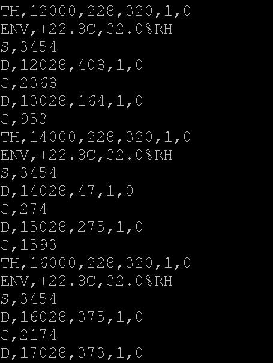  
</p>


SWV 데이터 그래프 (Trig & Echo & Dht)
<p align="center">
  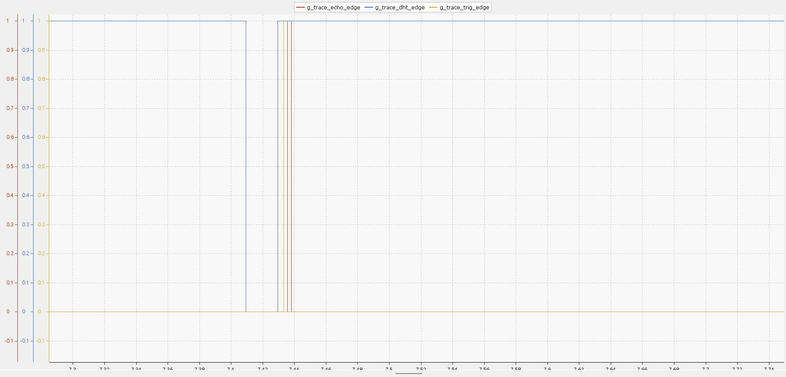  
</p>

---


